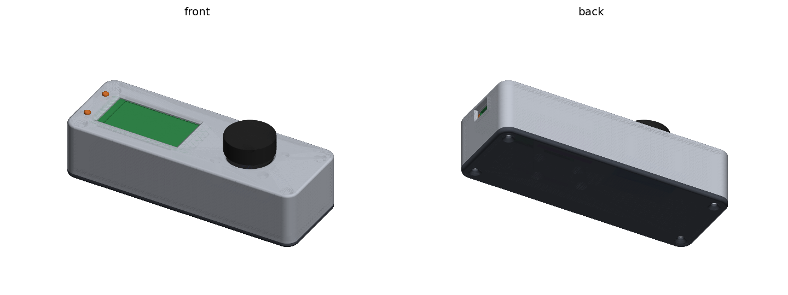

# Remote controller case

A 3D-printed case for the remote: LilyGo T-Display-S3 on the left, KY-023 joystick on the right, USB-C power through the left end.



Outer size: **130 × 46 × 31 mm**. It is that thick because of the T-Display-S3's pre-soldered pins: there is about 20 mm free behind the board for Dupont plugs and wire bends.

## Files

| File | What it is |
|---|---|
| `remote_case.py` | The design: a FreeCAD script with every dimension as a named parameter at the top |
| `render.py` | Draws the preview pictures |
| `out/remote_case_front.stl` | Front shell, full depth: screen window, joystick opening, button holes. Holds both boards. |
| `out/remote_case_back.stl` | Back cover: a flat plate with a short locating rim and four posts that press the T-Display-S3 against the front. Screws on from behind. |
| `out/remote_case_back_flat.stl` | Back cover variant: plain screw holes, the outside stays completely flat. For pan- or socket-head screws. |
| `out/remote_case_back_counterbore.stl` | Back cover variant: cylindrical 1.5 mm recesses for pan- or socket-head screws. **Needs supports.** |
| `out/remote_button_cap.stl` | Button extension for BOOT and KEY. **Print 2.** |
| `out/*.step` | The same parts as STEP files, for editing in FreeCAD or other CAD |
| `ref/t-display-s3-full.stp` | LilyGo's 3D model of the board, used for fit checks. Not in git (see below). |

## Building the STL files

```bash
cd hardware/remote-case
/Applications/FreeCAD.app/Contents/Resources/bin/freecadcmd remote_case.py
```

It takes a few seconds. It prints the case size, the case screw length, a check for each part (valid, one closed solid, size, volume) and checks every pair of parts for overlap. With the board model present it also checks the board against the case and caps. Every line must say `OK`.

To render the preview pictures too (takes a few minutes):

```bash
PREVIEW=1 /Applications/FreeCAD.app/Contents/Resources/bin/freecadcmd remote_case.py
```

The board model is LilyGo's file, so it isn't committed. To get it:

```bash
mkdir -p ref && curl -L -o ref/t-display-s3-full.stp https://raw.githubusercontent.com/Xinyuan-LilyGO/T-Display-S3/main/dimensions/t-display-s3-full.stp
```

Without it, the script still builds the case but skips the board fit checks.

## Printing (Bambu Lab, 0.4 mm nozzle)

| Part | Orientation | Notes |
|---|---|---|
| Front shell | **front face down** on the plate | No supports needed. The USB-C opening bridges about 13 mm. |
| Back cover | **outside down** (flat on the plate) | No supports. The rim and posts grow straight up from the plate, and the screw holes are 90° countersinks, which print as 45° slopes. |
| Back cover, `_flat` | outside down | No supports. |
| Back cover, `_counterbore` | outside down | **Supports on, "on build plate only"**: the roofs of the four screw-head recesses are flat overhangs. Small tree supports are enough. |
| Button caps ×2 | foot down, stem up | No supports. Small parts: print them with the shell, or use a brim. |

PLA or PETG, 0.2 mm layers, 3 walls, 15–20 % infill. A textured PEI plate gives the front face a nice finish.

## Assembly

You need 4× **M3×12 countersunk (flat head)** screws (case; pan-head M3×12 also work, but stick out 2 mm). With the `_flat` or `_counterbore` back cover use pan- or socket-head M3×12. and 4× **M3×6** screws (joystick). Both go into printed pilot holes, so self-tapping or ordinary machine screws both work in PLA/PETG. Don't overtighten.

1. **Button caps:** drop the two caps into the button holes from the inside of the front shell, stem first.
2. **T-Display-S3:** lay it screen-down into the front shell, USB-C towards the opening in the left end. The ribs locate it, and the glass sits against the inside of the front face.
3. **Joystick:** screw the KY-023 to the four standoffs, stick through the round opening.
4. **Wiring:** plug Dupont jumper wires onto the T-Display-S3's pins (they point towards the back cover) and lead them to the joystick header underneath the joystick board. Connect the joystick as described in the main README (VRx → GPIO1, VRy → GPIO2, SW → GPIO21, +5V pin → **3V3**, GND → GND).
5. **Back cover:** lay it on so its rim drops inside the front shell walls. Its four posts press the T-Display-S3 against the front. Screw it on with the M3×12 screws.

**Buttons:** with USB-C on the left, the two buttons sit left of the screen, one above the other. The **upper** button should be **BOOT** (arm/disarm) and the **lower** one **KEY** (speed gear). Check this on first power-up, since I worked it out from the board model, not a labelled drawing.

**Reset:** a small pinhole in the upper long side, near the left end, reaches the board's reset button. Use a paperclip.

The remote firmware turns the screen picture round to match the board's position in this case (`setRotation(3)` in `src/remote/Display.cpp`).

## Where the dimensions come from

- **T-Display-S3:** measured from LilyGo's official STEP model. PCB 60.78 × 25.5 × 1.2 mm; screen glass 49.87 × 25.95 mm, slightly wider than the PCB; both buttons on the screen side next to USB-C; tallest part on the back 3.5 mm.
  - The screen opening (46 × 23.5 mm) is the 1.9" panel's visible area (about 42.6 × 22.7 mm) plus a margin. The model doesn't show exactly where the visible area sits on the glass. If any pixels are hidden behind the frame, increase `win_l` / `win_w`.
- **Pin headers:** the pin positions come from the board model (two rows of 12 at 2.54 mm, along the long edges). The pin and plug sizes are standard values: 2.5 mm spacer, pins 8.5 mm from the PCB, Dupont housing 14 mm.
- **KY-023 joystick:** measured by you: PCB 34.0 × 26.0 mm, mounting holes 26.67 × 20.32 mm centre-to-centre.

### Still to measure on your joystick

These are typical values that set the case thickness and the size of the joystick opening. Measure them and change the parameters at the top of `remote_case.py`:

| Parameter | Typical value | What to measure |
|---|---|---|
| `js_hole_d` | 3.2 mm | mounting hole diameter |
| `js_body`, `js_body_h` | 20 × 20 mm, 12 mm | black housing footprint, and its height above the PCB top |
| `js_cap_d`, `js_cap_h`, `js_cap_z` | 26, 9, 17 mm | thumb cap diameter, cap height, height of the cap's underside above the PCB top (stick centred) |
| `js_stick_off` | 0, 0 | stick centre offset from the PCB centre |
| `js_header_side`, `js_header_clear` | +1, 18 mm | which short edge the header is on, and how far the plugs stick out |
| `js_hole_d_face` | 24 mm | stick opening. Must let the stick tilt fully without hitting the face. |

## Back cover style

The default (`joint="flat"`) is a deep front shell with a flat back plate. It is the easiest to print.

There is also `JOINT=skirt`: a shallow front shell and a tray-shaped back cover whose outer wall rises past the joint and wraps round the bottom of the front shell. It needs 2.6 mm walls and M3×20 screws in counterbores with 45° roofs:

```bash
JOINT=skirt /Applications/FreeCAD.app/Contents/Resources/bin/freecadcmd remote_case.py
```

## Main parameters

| Parameter | Default | Meaning |
|---|---|---|
| `fit` | 0.3 mm | clearance around boards |
| `wall`, `face`, `floor` | 2.0, 2.0, 2.5 mm | wall, front face and back plate thicknesses |
| `rim_t`, `rim_h` | 1.2, 2.0 mm | locating rim on the back plate |
| `screw_len` | auto (12) | case screw length; the script picks the shortest that bites ≥ 8 mm |
| `width` | 46 mm | case width. The length follows from the joystick position and header room. |
| `td_wire_clear` | 20 mm | free room from the T-Display-S3's PCB back to the inside of the back cover: spacer + Dupont plug + wire bend. **Sets the case thickness.** If you solder wires straight to the pins, about 12 mm is enough and the case gets 8 mm thinner. |
| `js_x` | 93 mm | joystick centre, measured from the left end |
| `corner_r`, `edge_r` | 6, 1.2 mm | corner and edge rounding |
| `win_l`, `win_w` | 46 × 23.5 mm | screen opening |
| `cap_hole_d`, `cap_d` | 3.7, 3.2 mm | button hole and cap stem diameters |
